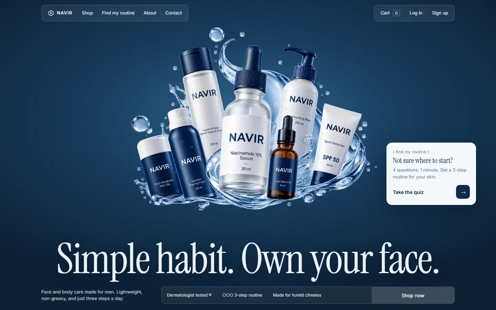
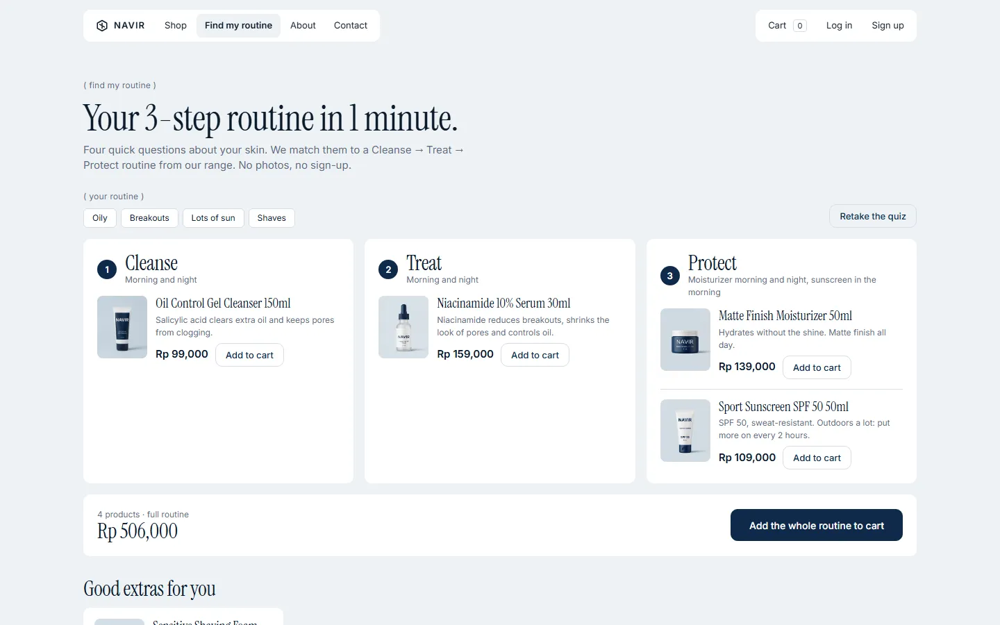
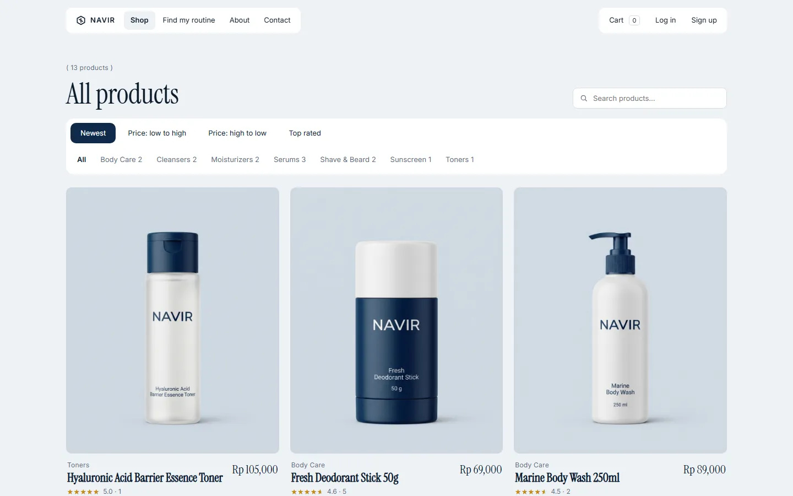
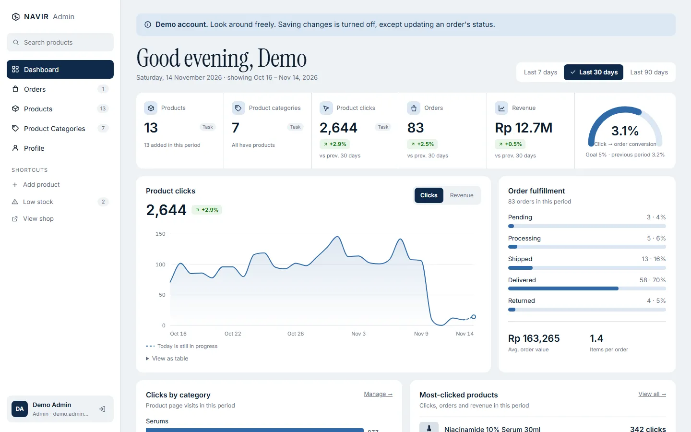
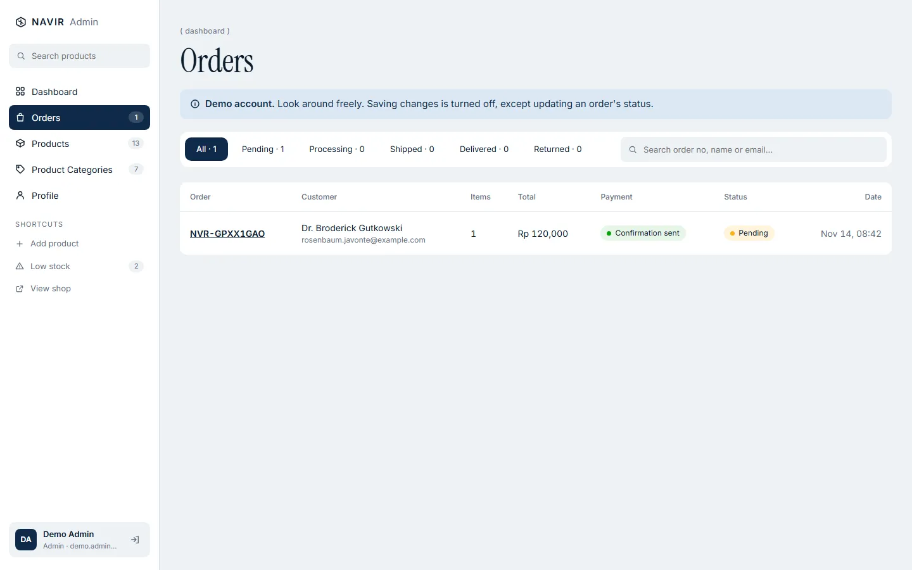
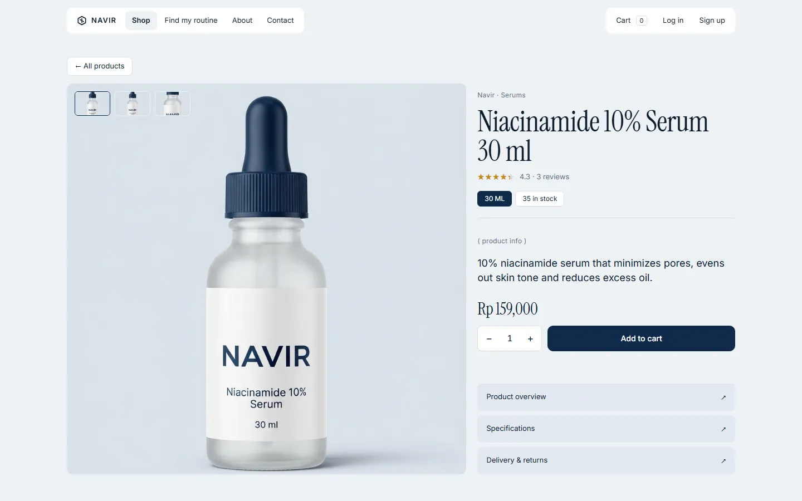
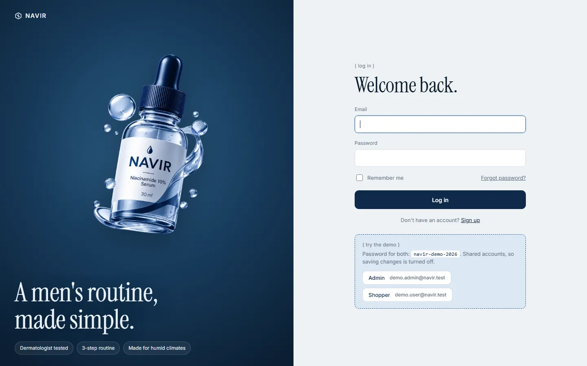
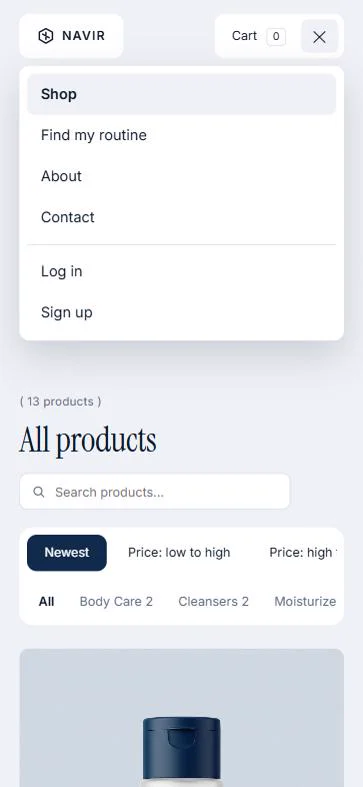
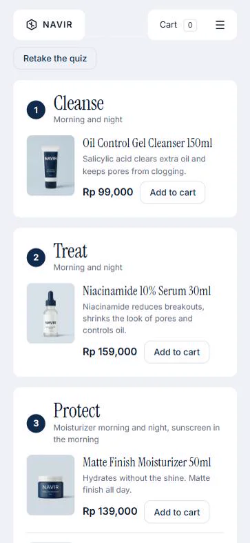

# NAVIR · Men's Skincare Shop

A full online shop for a (fictional) men's skincare brand, built with **Laravel**.
Customers can browse, search, take a skin quiz, order and track their orders;
admins manage products, orders and users from a dashboard.

**Live demo: [navir.site.je](https://navir.site.je)**



---

## Try it

Use the **"Try the demo"** buttons on the log-in page, or:

| Role | Email | Password |
|---|---|---|
| Shopper | `demo.user@navir.test` | `navir-demo-2026` |
| Admin | `demo.admin@navir.test` | `navir-demo-2026` |

Demo accounts are shared, so they are **read-only**: you can open every page, but saving changes is turned off.
The shopper can still shop, place orders and write reviews, and the admin can still move an order's status, so the whole order flow can be tried.

---

## Features

### For customers
- **Shop** with categories, sorting (newest, price, top rated), **search** and pagination
- **Find my routine**: a 4-question skin quiz that builds a 3-step routine (Cleanse → Treat → Protect) from the real products, with a reason for each one and "add the whole routine to cart"
- **Product pages** with photos, stock, related products and **reviews** (1–5 stars, verified buyers only)
- **Cart** without logging in (quantities, free-shipping progress bar), then **checkout** with shipping details
- **Payment step**: bank-transfer details plus a confirmation form whose message is filled in automatically
- **My orders**: order history and a status tracker (Order placed → Processing → Shipped → Delivered)
- Fully **mobile friendly** (phone menu, stacked layouts, swipeable filters)

### For admins
- **Dashboard** with KPIs, trend charts, clicks by category, top products and order fulfilment
- **Orders**: list with status tabs and search, order details (items, address, payment message) and status updates
- **Products & categories**: add, edit, delete, photo upload, low-stock filter
- **User management** (System Admin only): change roles or delete users

### Roles
| Role | Can use |
|---|---|
| User | Shop, quiz, cart, checkout, my orders, profile |
| Admin | Everything above + dashboard, orders, products, categories |
| System Admin | Everything above + user management |

---

## Screenshots

| Find my routine | Shop |
|---|---|
|  |  |

| Admin dashboard | Admin orders |
|---|---|
|  |  |

| Product page | Log in with demo accounts |
|---|---|
|  |  |

**On a phone**

<p>
  
  
  
</p>

---

## Tech stack

- **Backend:** PHP 8.3+, Laravel 13, Laravel Breeze (log in, sign up, password reset)
- **Database:** MySQL (SQLite in memory for the tests)
- **Frontend:** Blade templates, plain CSS and a little vanilla JavaScript (no build step)
- **Tests:** PHPUnit, 105 feature tests
- **Hosting:** InfinityFree shared hosting (FTP upload, phpMyAdmin)

---

## Run it locally

Requirements: PHP 8.3+, Composer, MySQL.

```bash
git clone https://github.com/Chua-wd/navir-shop.git
cd navir-shop
composer install
cp .env.example .env
php artisan key:generate
```

Create an empty MySQL database, put its name, user and password in `.env` (`DB_DATABASE`, `DB_USERNAME`, `DB_PASSWORD`), then:

```bash
php artisan migrate --seed
php artisan serve
```

Open http://127.0.0.1:8000 and log in with a demo account above.

The seeder adds the products and photos, 40 sample customers with orders and reviews, and the two demo accounts.
To also create your own **System Admin**, add `ADMIN_EMAIL` and `ADMIN_PASSWORD` to `.env` before seeding.

Run the tests:

```bash
php artisan test
```

---

## How some parts work

- **Stock never goes below zero.** Placing an order runs in a database transaction that locks the product rows, so two people can't buy the last item at the same time.
- **Prices come from the database**, never from the browser. The cart only stores product IDs and quantities.
- **Roles are checked on the server** with middleware, not only by hiding buttons. A user who types an admin URL gets "403".
- **Reviews are for verified buyers only**: you need an order for that product (returned orders don't count).
- **The routine quiz** is a small set of readable rules (`app/Support/RoutineFinder.php`). For example, sensitive skin never gets the salicylic acid cleanser. If a product is renamed or deleted, it picks another one from the same category.
- **Demo accounts** are blocked from saving changes by one middleware (`app/Http/Middleware/DemoReadOnly.php`).

---

## What I learned

- **Deploying Laravel to free shared hosting** without SSH or Composer: uploading `vendor` over FTP, sending all traffic to `public/` with `.htaccess`, keeping `.env` private, and applying database changes as SQL in phpMyAdmin.
- **Designing roles and permissions** (user, admin, system admin) and protecting every route on the server.
- **Keeping data correct**: transactions and row locks for stock, server-side prices, one review per customer per product.
- **Writing feature tests** for real user flows (cart → checkout → payment → admin status update), which caught several bugs before they reached the live site.
- **Mobile-first CSS**: testing every page at phone width and fixing what broke (navigation, wide tables, filter rows).

---

## Project structure (main parts)

```
app/Http/Controllers/      Shop, cart, checkout, orders, reviews, quiz, admin pages
app/Http/Middleware/       Admin, system admin and demo read-only checks
app/Support/               Cart (session) and RoutineFinder (quiz rules)
config/shop.php            Shipping fee, bank details, demo accounts
database/migrations/       Tables
database/sql/              The same changes as plain SQL, for hosting without artisan
resources/views/           Blade pages and components
tests/Feature/             The 105 tests
```

---

*Navir is a fictional brand made for this portfolio. Product photos were generated with AI. Payment is a demo: no real money is involved.*
